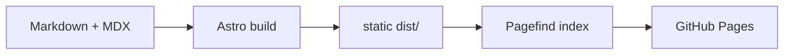

This site is plain files. Articles, lab notes and radar entries are Markdown or MDX files in the repository, [Astro](https://astro.build) turns them into static HTML, and GitHub Pages serves the result at blog.ithings.ch. Nothing runs on a server once the pages are built.

## The pipeline



Everything visual that can be computed is computed once, during the build:

- **Isolines.** Each entry draws its own contour-line terrain. Its id is hashed (FNV-1a) to seed a small pseudo-random generator, which places a few gaussian hills; marching squares then traces the contour lines as SVG paths. The same entry always draws the same terrain.
- **The wordmark.** The logo is not drawn by hand. A script shapes the word with HarfBuzz from Instrument Sans at weight 600, outlines it, and centres the signal arcs on the stem of the first letter, measured in the font.
- **Diagrams.** Mermaid blocks and Excalidraw drawings are rendered in a headless Chromium, once per theme. Both versions ship, and CSS shows the one that matches the theme toggle.

The build also validates as it goes. Every entry's frontmatter is checked against a Zod schema — dates, rings, languages, demo flags — so a wrong field fails the build instead of shipping a wrong page. The three typefaces are self-hosted: the build downloads them once from Fontsource, through Astro's Fonts API, and serves them from the site itself. And the whole thing is tested: Vitest runs over the pure helpers, and the build is produced twice, once with the demo content and once without it, and both outputs are read back by the tests.

## Isolines, in code

The generator lives in `src/lib/isolines.ts`; it is pure and DOM-free, so it can run wherever the build needs a terrain. The level list is float-safe — `levels(0.06, 1.2, 0.08)` is exactly fifteen values — and the marching-squares pass is verbatim:

```ts title="src/lib/isolines.ts"
export function levels(from: number, to: number, step: number): number[] {
  const count = Math.floor((to - from) / step + 1e-9) + 1;
  const result: number[] = [];
  for (let i = 0; i < count; i++) {
    const v = from + i * step;
    result.push(Math.round(v * 1e9) / 1e9);
  }
  return result;
}

export function contourField(
  f: (x: number, y: number) => number,
  w: number,
  h: number,
  levelList: number[],
  cell = 4,
): Contour[] {
  const nx = Math.ceil(w / cell) + 1;
  const ny = Math.ceil(h / cell) + 1;
  const g = new Float32Array(nx * ny);
  for (let j = 0; j < ny; j++) {
    for (let i = 0; i < nx; i++) {
      g[j * nx + i] = f(i * cell, j * cell);
    }
  }

  return levelList.map((level, index) => {
    let d = "";
    for (let j = 0; j < ny - 1; j++) {
      for (let i = 0; i < nx - 1; i++) {
        const a = g[j * nx + i];
        const b = g[j * nx + i + 1];
        const c = g[(j + 1) * nx + i + 1];
        const e = g[(j + 1) * nx + i];
        const mask =
          (a > level ? 8 : 0) | (b > level ? 4 : 0) | (c > level ? 2 : 0) | (e > level ? 1 : 0);
        if (mask === 0 || mask === 15) continue;

        const x = i * cell;
        const y = j * cell;
        const T: Point = [x + (cell * (level - a)) / (b - a), y];
        const R: Point = [x + cell, y + (cell * (level - b)) / (c - b)];
        const B: Point = [x + (cell * (level - e)) / (c - e), y + cell];
        const L: Point = [x, y + (cell * (level - a)) / (e - a)];

        for (const [p1, p2] of segmentsFor(mask, T, R, B, L)) {
          d += `M${p1[0].toFixed(1)} ${p1[1].toFixed(1)}L${p2[0].toFixed(1)} ${p2[1].toFixed(1)}`;
        }
      }
    }
    return { level, major: index % 4 === 0, d };
  });
}
```

The `segmentsFor` segment table — which corner of a cell sits above the
level — stays in the module; the excerpt above is the part that turns the
sampled field into path data. One line in four is marked as the *index
contour*, the heavier line a topographic map draws.

## Where it runs

<Excalidraw
  src="./site-architecture.excalidraw"
  alt="Markdown and MDX files in src/content go into the Astro build, which writes static files to dist; GitHub Pages serves them at blog.ithings.ch."
  caption="From source to site: the build does the drawing, GitHub Pages only serves files."
/>

A push to the main branch starts a GitHub Actions workflow that installs the dependencies, builds the site with Node.js 24 and publishes the `dist` folder to GitHub Pages.

## The editorial pipeline

Everything that produces the site — the contents, the diagram sources, the two generators and the test suite — lives in the same public repository as the result. Writing an article is editing files; the schemas check what an entry declares, `astro check` checks the code, and the build tests walk both outputs before anything ships. Publishing is a merge to the main branch, and the pipeline above takes it from there. The [Lab note on the wordmark](/lab/wordmark-from-font-geometry) tells the part of the story the logo came from.