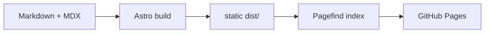

This site is plain files. Articles, lab notes and radar entries are Markdown or MDX files in the repository, [Astro](https://astro.build) turns them into static HTML, and GitHub Pages serves the result at blog.ithings.ch. Nothing runs on a server once the pages are built.

## The pipeline

Everything visual that can be computed is computed once, during the build:

- **Isolines.** Each entry draws its own contour-line terrain. Its id is hashed (FNV-1a) to seed a small pseudo-random generator, which places a few gaussian hills; marching squares then traces the contour lines as SVG paths. The same entry always draws the same terrain.
- **The wordmark.** The logo is not drawn by hand. A script shapes the word with HarfBuzz from Instrument Sans at weight 600, outlines it, and centres the signal arcs on the stem of the first letter, measured in the font.
- **Diagrams.** Mermaid blocks and Excalidraw drawings are rendered in a headless Chromium, once per theme. Both versions ship, and CSS shows the one that matches the theme toggle.

## Where it runs

<Excalidraw
  src="./site-architecture.excalidraw"
  alt="Markdown and MDX files in src/content go into the Astro build, which writes static files to dist; GitHub Pages serves them at blog.ithings.ch."
  caption="From source to site: the build does the drawing, GitHub Pages only serves files."
/>

A push to the main branch starts a GitHub Actions workflow that installs the dependencies, builds the site with Node.js 24 and publishes the `dist` folder to GitHub Pages.
