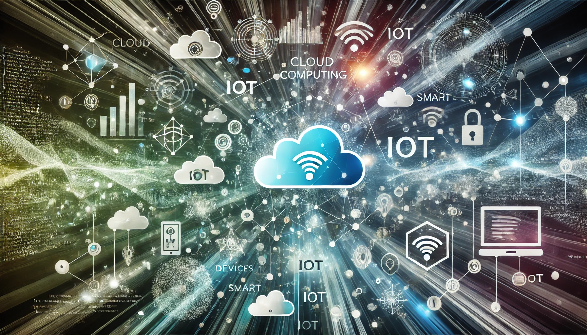

Hello, tech enthusiasts!

Welcome to my blog - your resource for everything **Infrastructure as Code**, **Containerization**, **Cloud Computing**, **Site Reliability Engineering**, , **Linux**, and **IoT**.

<!-- truncate -->

## Why This Blog?

In the rapidly evolving landscape of technology, staying up-to-date with the latest trends, tools, and best practices is crucial. This blog aims to be a resource for both newcomers and seasoned professionals.

Here's what you can expect:

- **Infrastructure as Code** — Terraform, Crossplane, AWS CDK, and Ansible
- **Containerization** — Docker, Kubernetes, Operators, and modern deployment strategies
- **Cloud Infrastructure** — Deep dives into AWS, Azure, Google Cloud, OCI and more
- **SRE & Platform Engineering** — Monitoring, observability, developer experience, and incident response
- **Linux & NixOS** — Tips, tricks, and system management guides
- **IoT Innovations** — From smart home solutions to industrial applications

## Join the Conversation

This blog is not just about sharing knowledge; it's about building a community. I encourage you to engage in discussions, ask questions, and share your insights. Together, we can stay ahead in this ever-changing field.

## Stay Updated

Detailed tutorials and thought pieces will be dropping soon. Bookmark this page or follow me on social media to stay updated.

Ready to embark on this journey? Let's go!

Thank you for being part of this community from the beginning!
